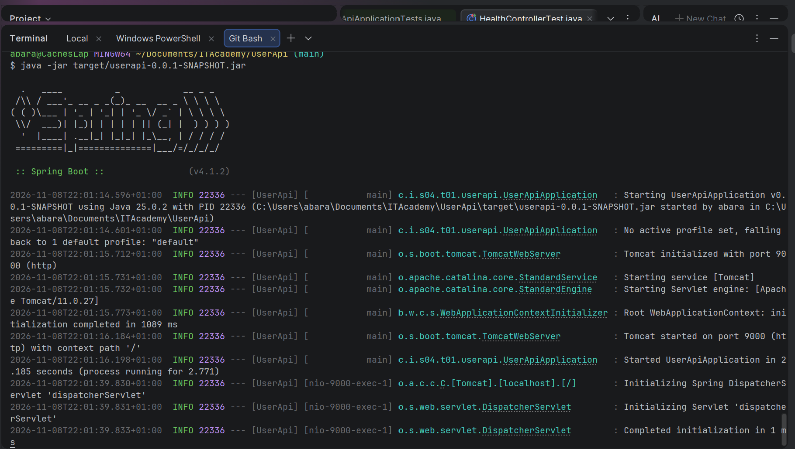

# Sprint 4 — Exercise 01: UserApi (REST API with Spring Boot)

This project represents a practical implementation of a RESTful Web API built with **Spring Boot 3** and **Java 21**, developed as part of the IT Academy backend specialization.

The primary objective of this exercise is to build a functional and maintainable REST API by progressively evolving an initial controller-centric prototype into a fully decoupled **layered architecture (Controller → Service → Repository)**. The project emphasizes software engineering fundamentals, including SOLID design principles, Inversion of Control (IoC), Dependency Injection, and rigorous testing methodologies (unit, web-layer, and integration tests using JUnit 5, MockMvc, and Mockito).

---

## Tech Stack

* **Language:** Java 21
* **Framework:** Spring Boot 3 (Spring Web, Spring Boot DevTools)
* **Build Tool:** Maven
* **Testing:** JUnit 5, MockMvc, Mockito, AssertJ
* **Configured Port:** `9000` (set in `src/main/resources/application.properties`)

---

##  Project Roadmap & Implementation

### 🟢 Level 1: First Contact & Health Check
The priority here was verifying the environment setup, ensuring the embedded Tomcat server starts up properly, and writing our first automated web test.

* **What was required?**
  * Run the server on port `9000`.
  * Build a `/health` endpoint returning a basic status.
  * Upgrade the response from plain text to a structured JSON object.
  * Add our first automated test for the web layer.
  * Package the application into an executable `.jar` file and run it standalone.

* **What did we build?**
  1. Created [`HealthController`](src/main/java/cat/itacademy/s04/t01/userapi/controllers/HealthController.java) with a `@GetMapping("/health")`.
  2. Created the record [`HealthStatus`](src/main/java/cat/itacademy/s04/t01/userapi/HealthStatus.java) so Jackson automatically converts the response to `{ "status": "OK" }`.
  3. Created [`HealthControllerTest`](src/test/java/cat/itacademy/s04/t01/userapi/controllers/HealthControllerTest.java) using `@WebMvcTest(HealthController.class)` and `MockMvc` to verify HTTP 200 status and the JSON payload.
  4. Packaged the app via `./mvnw clean package` and ran `java -jar target/userapi-0.0.1-SNAPSHOT.jar`.

#### Standalone JAR Execution Evidence


---

### 🟡 Level 2: In-Memory User Management (All in the Controller)
Time to handle real data and learn how to receive, process, and return JSON using different HTTP methods and parameters.

* **What was required?**
  * Manage users in memory using an internal list inside the controller.
  * `GET /users`: Return all users (or an empty array initially).
  * `POST /users`: Create a user with a generated `UUID`.
  * `GET /users/{id}`: Look up a user by ID using `@PathVariable` (returns `404 Not Found` if missing).
  * `GET /users?name=...`: Filter users by name (case-insensitive) using `@RequestParam`.
  * Write full web-layer tests for all endpoints.

* **What did we build?**
  1. Defined the [`User`](src/main/java/cat/itacademy/s04/t01/userapi/model/User.java) entity record, plus [`UserRequest`](src/main/java/cat/itacademy/s04/t01/userapi/dtos/UserRequest.java) and [`UserResponse`](src/main/java/cat/itacademy/s04/t01/userapi/dtos/UserResponse.java) DTOs to decouple external payloads from internal models.
  2. Created [`UserNotFoundException`](src/main/java/cat/itacademy/s04/t01/userapi/exceptions/UserNotFoundException.java) annotated with `@ResponseStatus(HttpStatus.NOT_FOUND)`.
  3. Initially held the state directly inside [`UserController`](src/main/java/cat/itacademy/s04/t01/userapi/controllers/UserController.java) to understand basic endpoint mechanics.
  4. Covered all scenarios with [`UserControllerTest`](src/test/java/cat/itacademy/s04/t01/userapi/controllers/UserControllerTest.java) verifying status codes and response bodies using `ObjectMapper`.

---

### 🔴 Level 3: Refactoring to Layered Architecture & TDD
Having business rules and data storage inside the controller breaks the Single Responsibility Principle (SRP). We redesigned the application into three decoupled layers:

```
[ HTTP Request ] 
       │
       ▼
[ UserController ]      --> Receives requests, maps DTOs, returns HTTP responses
       │
       ▼
[ UserService ]         --> Business logic, rules, and validations
       │
       ▼
[ UserRepository ]      --> Data access (In-memory list simulation)
```

#### 1. Integration Testing as a Safety Net
Before breaking apart the controller, we switched [`UserControllerTest`](src/test/java/cat/itacademy/s04/t01/userapi/controllers/UserControllerTest.java) from `@WebMvcTest` to:
* `@SpringBootTest` + `@AutoConfigureMockMvc`
* **Why?** This gave us full confidence that our end-to-end user flows wouldn't break while rearranging the code.

#### 2. Repository Layer (Data Access)
* Created [`UserRepository`](src/main/java/cat/itacademy/s04/t01/userapi/repositories/UserRepository.java) interface defining the contract (`save`, `findAll`, `findById`, `searchByName`, `existByEmail`).
* Implemented [`InMemoryRepository`](src/main/java/cat/itacademy/s04/t01/userapi/repositories/InMemoryRepository.java) annotated with `@Repository`.
* Built [`InMemoryRepositoryTest`](src/test/java/cat/itacademy/s04/t01/userapi/repositories/InMemoryRepositoryTest.java) to test data mutations in complete isolation.

#### 3. Service Layer (Business Logic)
* Created [`UserService`](src/main/java/cat/itacademy/s04/t01/userapi/service/UserService.java) interface and [`UserServiceImp`](src/main/java/cat/itacademy/s04/t01/userapi/service/UserServiceImp.java) with `@Service`.
* Used **constructor injection** for clean Inversion of Control (IoC).
* Simplified [`UserController`](src/main/java/cat/itacademy/s04/t01/userapi/controllers/UserController.java) so it only delegates work to `UserService`.

#### 4. Unit Testing with TDD & Mockito
* Added a business validation rule: **email addresses must be unique**.
* Created [`EmailAlreadyExistException`](src/main/java/cat/itacademy/s04/t01/userapi/exceptions/EmailAlreadyExistException.java).
* Built unit tests in [`UserServiceImpTest`](src/test/java/cat/itacademy/s04/t01/userapi/service/UserServiceImpTest.java) using `@ExtendWith(MockitoExtension.class)`:
  * **Error path:** When the email exists, verify `EmailAlreadyExistException` is thrown and `verify(userRepository, never()).save(any())`.
  * **Happy path:** When the email does not exist, verify the user is saved and a valid `UserResponse` with generated ID is returned.

---

## Running the Tests

To run the whole test suite (unit + integration tests):

```bash
./mvnw test
```

To run a specific test class:
```bash
./mvnw test -Dtest=UserServiceImpTest
```

---

## How to Run the App

1. **Via Maven:**
   ```bash
   ./mvnw spring-boot:run
   ```
2. **Via Executable JAR:**
   ```bash
   ./mvnw clean package
   java -jar target/userapi-0.0.1-SNAPSHOT.jar
   ```

The API will be available at: `http://localhost:9000`

### Quick Endpoint Reference:
* `GET  /health` - Application health check
* `GET  /users` - List all users
* `GET  /users?name={query}` - Filter users by name
* `GET  /users/{id}` - Get user by UUID
* `POST /users` - Create user (`{"name": "Ada Lovelace", "email": "ada@example.com"}`)
